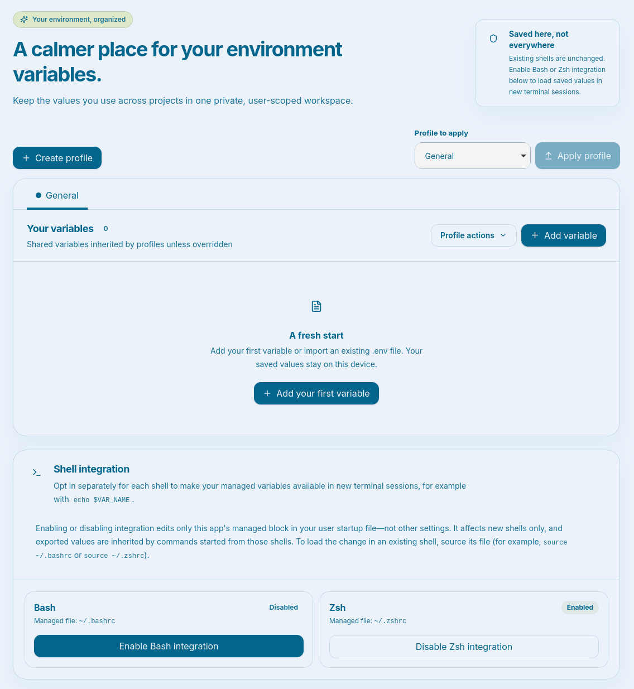
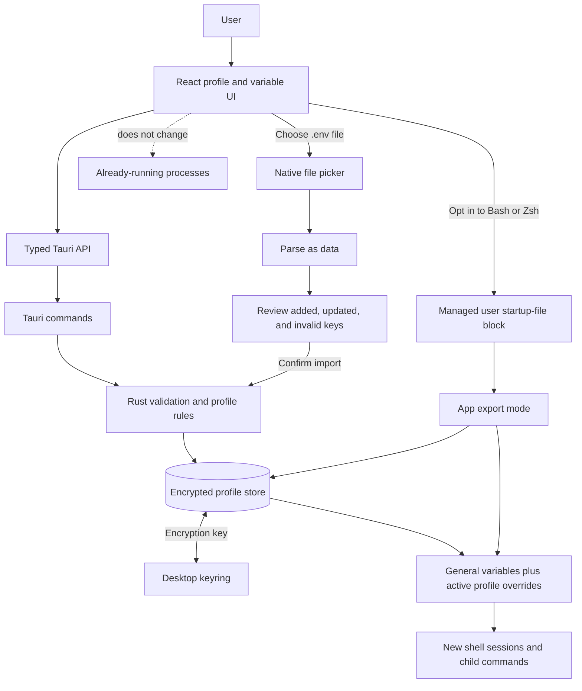

# Linux Environment Manager

A small Tauri v2 desktop app for managing **user-scoped, app-owned environment profiles**. Add, edit, delete (with confirmation), and import variables from a `.env` file.



> **Important:** Linux environment variables belong to processes. Saving updates this app's user-scoped store; it does not change this running app, existing terminals, or other processes. Bash/Zsh startup integration is available separately and is always opt-in. The app never edits `/etc/environment` or system-wide configuration.

The interface uses Inter from Google Fonts and falls back to the system sans-serif font. When online, the WebView requests the font from Google Fonts; variable data is not sent with that request.

## Requirements

- Linux with GTK 3 and WebKitGTK 4.1 development packages
- Node.js `24.14.0` (see `.nvmrc`)
- Corepack and PNPM `12.16.1`
- Rust stable toolchain with Cargo (install with [rustup](https://rustup.rs/))
- A Secret Service-compatible desktop keyring (for example, GNOME Keyring or KWallet) for encryption-key storage

Tauri's Linux build dependencies vary by distribution. Examples:

```sh
# Fedora
sudo dnf install pkgconf-pkg-config gtk3-devel webkit2gtk4.1-devel openssl-devel curl wget file \
  libxdo-devel librsvg2-devel libayatana-appindicator-gtk3

# Debian / Ubuntu
sudo apt install build-essential pkg-config curl wget file libgtk-3-dev libssl-dev libxdo-dev \
  libayatana-appindicator3-dev librsvg2-dev libwebkit2gtk-4.1-dev
```

Alternatively, `make install-linux-deps` detects Fedora (`dnf`) or Debian/Ubuntu (`apt-get`) and invokes `sudo` to install these packages.

The development WebKit requirement is `webkit2gtk-4.1`; the application uses the native GTK file picker through Tauri's dialog plugin.

## Install and run

```sh
# Install Rust and Cargo if they are not already available
make install-rust
. "$HOME/.cargo/env"
cargo --version

# Install the Linux Tauri development packages shown above, then select Node
# at the repository-pinned version (with nvm)
nvm install
nvm use
corepack enable
corepack prepare pnpm@12.16.1 --activate

make install
make dev
```

`make dev` launches the Vite frontend in the Tauri desktop window. To produce Linux bundles locally, run `make build` (the bundle targets are Debian, RPM, and AppImage).

## CI and GitHub Releases

GitHub Actions runs the quality checks and builds the frontend and Tauri application on pushes and pull requests. Releases use [Conventional Commits](https://www.conventionalcommits.org/): `fix:` creates a patch release, `feat:` creates a minor release, and a commit marked with `!` or a `BREAKING CHANGE:` footer creates a major release. Other commit types do not trigger a release by themselves.

When release-worthy commits reach `main`, Release Please opens or updates a release pull request with the calculated version, synchronized `package.json` / Cargo / Tauri versions, and `CHANGELOG.md`. Merging that PR creates the version tag and GitHub Release; the release workflow then builds and attaches the Linux AppImage, Debian package, and RPM. No manual version edits or tag creation are needed. Repository Actions settings must allow GitHub Actions to create pull requests.

The `.AppImage` asset is the directly executable Linux build. After downloading it, make it executable and launch it:

```sh
chmod +x ./*.AppImage
./*.AppImage
```

The AppImage requires a compatible Linux system with the WebKitGTK 4.1 runtime installed. Debian and RPM packages are also attached for systems where installing a package is preferred. See [GitHub Releases](https://github.com/thiagodsantos/linux-env-manager/releases) for published builds. `CHANGELOG.md` records release changes.

## Usage

- The **General** profile is shared by every profile. Its variables are inherited unless a profile defines a local override.
- Create profiles with a description, color, and optional starting copy of another profile's effective variables. Profiles appear as colored tabs.
- Add and edit validate keys against `^[A-Za-z_][A-Za-z0-9_]*$`. The add form rejects duplicates; editing an inherited variable creates a profile-local override. Inherited-only values cannot be deleted from a custom profile.
- Profile actions groups `.env` import, clearing the selected profile's own variables, and deleting a custom profile. General cannot be deleted. Deleting a profile requires confirmation and removes its profile-local variables; if it was active, General becomes active.
- Deleting a variable always asks for confirmation. Clearing a custom profile preserves inherited General values.
- Import opens a native file picker, previews added/updated keys and invalid lines, then applies all valid assignments to the selected profile in one store replacement. A file with any invalid line cannot be applied; fix the file and preview it again.

### `.env` import syntax

The parser treats the selected file as UTF-8 text; it never executes or sources it. Supported behavior:

- Blank lines and lines whose first non-space character is `#` are ignored.
- `KEY=value` is supported; the first `=` separates key from value, so later `=` characters are preserved.
- An optional `export ` prefix is accepted (`export KEY=value`).
- Leading/trailing whitespace around the assignment and unquoted value is trimmed.
- Matching single or double quotes around the entire value are removed. Backslash escapes are not interpreted. Interpolation such as `$HOME` is kept literally. Inline comments are not special and remain part of the value.
- Repeated keys in one file use the final valid assignment.
- Invalid keys, assignments without `=`, unmatched outer quotes, and NUL characters are reported by line number. No values or raw malformed content are included in the preview error messages. The entire import is blocked until all invalid lines are fixed.

The preview reports keys only, never their values. At apply time, incoming keys replace existing values and new keys are added. The backend validates and persists the merge as a single atomic store update.

## Persistence and privacy

The canonical store is `variables.json` in Tauri's per-user application configuration directory (typically `$XDG_CONFIG_HOME/dev.linuxenvmanager.app/variables.json`, or `~/.config/dev.linuxenvmanager.app/variables.json`). Version 2 stores profile metadata and variables as AES-256-GCM authenticated ciphertext; the random encryption key is kept in the current user's Secret Service-compatible desktop keyring, not alongside the JSON file. Unlock/configure the keyring before using the app. Older version-1 single-environment data is migrated into General and encrypted on its first successful load. If the keyring entry is removed, the encrypted store cannot be recovered from the JSON file alone; restore the keyring entry or a matching backup. Writes use a temporary file followed by atomic rename, and Unix files/directories are restricted to the current user where supported. Encryption protects the file and ordinary backups at rest, but not a compromised user account, a running app, or values after they are revealed or exported.

### Optional Bash/Zsh integration

The **Shell integration** section in the app can be enabled separately for Bash (`~/.bashrc`) and/or Zsh (`~/.zshrc`). Enabling adds only a clearly marked manager-owned block to that user's selected startup file; disabling removes only that block and preserves the rest of the file. The app does not write `/etc/environment` or any system shell configuration.

On each new interactive Bash or Zsh session, the managed block invokes the app executable in export mode. The app decrypts the store through the desktop keyring and returns validated, shell-quoted `export` assignments for the currently selected profile (General values plus that profile's local overrides); plaintext values are not written into the startup file. Selecting a profile in the app changes which profile is exported by future shells. Imported `.env` text is never sourced or evaluated. Add/edit/delete/import changes are therefore available to the next shell session. Exported values are inherited by commands started from that shell. Existing shells and other running processes are unchanged; open a new terminal or manually source the corresponding RC file (for example, `source ~/.bashrc`). Shell integration is opt-in and limited to Bash and Zsh; other shells are not currently supported.

## Quality checks

```sh
make lint
make typecheck
make test            # Vitest UI/unit tests and Cargo backend tests
make test-coverage   # Frontend coverage; 81% minimum in all four categories
make check           # lint, typecheck, tests, coverage, and Rust formatting
```

The frontend uses Vitest, React Testing Library, and user-event. Rust domain/parser/storage tests run with `cargo test`; the frontend coverage report does not represent Rust coverage. `make check` is the documented local quality gate. PNPM is locked through `pnpm-lock.yaml`.

## App flow



The diagram shows two boundaries: imports are parsed and reviewed before storage, and shell integration affects future sessions only—not processes that are already running.

## Architecture

- `src/api.ts` is the typed Tauri command boundary; components do not invoke native commands directly.
- `src/components/` uses a lightweight atoms/molecules/organisms/templates/pages organization.
- `src-tauri/src/lib.rs` contains independently tested key validation, parsing, merge rules, atomic persistence, and thin Tauri commands.
- Import paths in frontend code use the `@/*` alias for `src/*`.
